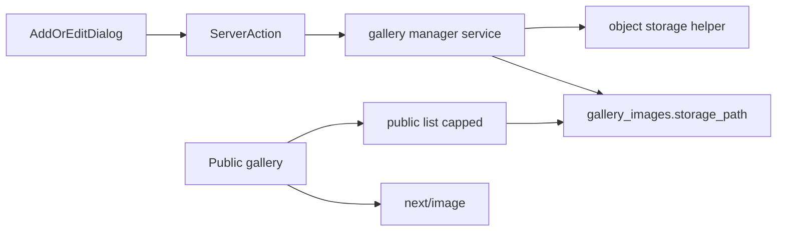

# Gallery storage

Gallery rows store the object path. The public site and the manager UI build the URL from that path. `next/image` resizes the original file when it is displayed.

## Data

- Table `gallery_images`: `name` + `storage_path` (unique). `storage_path` includes the `gallery/` prefix.
- Bucket `gallery`: public read, service-role writes, 15 MB, jpeg / png / webp / gif.
- Display URL comes from `getGalleryImagePublicUrl` in `lib/manager/gallery/storage-path.ts`.
- Uploads keep the original bytes and content type. Object name: `gallery/{uuid}-{safeFileName}`.

## Code

- Shared upload/remove: `repositories/object-storage.repository.ts`
- Manager list, create, update, delete: `services/gallery/gallery-image.service.ts`
- Public list: `services/public/gallery-image.service.ts` (cached, newest `PUBLIC_GALLERY_LIMIT` = 48)
- Manager list is paged (name search, default page size 12) via `loadGalleryImagesPageAction`
- One file check: `validateGalleryImageClientFile` (dropzone and Zod)

## Create, replace, delete

- Create: upload, then insert. If the insert fails, remove the object.
- Replace: upload the new object, update `storage_path`, then remove the old object. If the old remove fails, return an error.
- Delete: remove the object first. If that fails, keep the row and return an error.

Smoke: `npm run smoke:gallery`.
