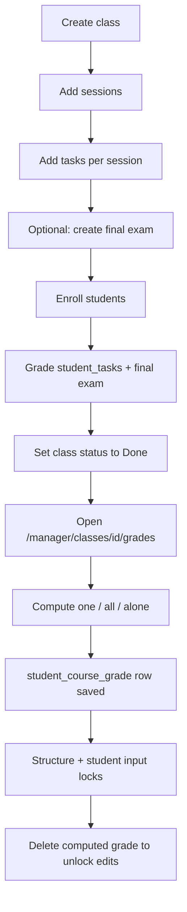

# [01] Grades business logic audit

**Project:** Etkan MS (`etkan_ms`)  
**Date:** 2026-07-12  
**Scope:** Class → Sessions → Tasks → Final exam → Student course grades (plus attendance, group levels, compute weights, locks)  
**Purpose:** Verify the academic grading flow is coherent; call out broken paths, design drift, and edge cases managers should handle now.

---

## Executive summary

Manager class grading is **wired end-to-end to Supabase** (not mock). The happy path works:

1. Build class structure (sessions → tasks → final exam)  
2. Enter student task / final-exam grades (+ attendance)  
3. Set class status to **Done**  
4. Compute course grades (locks structure + that student’s inputs)  
5. Delete a computed grade to unlock edits and recompute  

The **persisted compute is a 2-factor model** (tasks + final exam, default **60 / 40**). Course-grade UI copy matches that model. Per-task weights are applied by official compute and fast certificate via a shared weighted-sum helper. Late enroll seeds `student_tasks` (mirrors final exam / attendees).

| Area | Verdict |
|------|---------|
| Class / session / task CRUD + structure locks | Working |
| Final exam create + student exam grades | Working |
| Attendance rows + updates | Working (does **not** affect course total) |
| Grades UI gated on class **Done** | Working |
| Compute + delete + input locks | Working |
| Per-task weight customization in compute dialogs | **Done✅** (applied in persisted compute) |
| Late join after tasks exist | **Done✅** (`student_tasks` seeded) |
| Group / attendance in course total | **Not in formula** (UI aligned to 2-factor; JSON columns unused) |
| Fast certificate vs saved grade | **Done✅** (shared weighted-sum helper) |
| Final exam metadata edit after compute | **Done✅** (structure-locked) |
| Membership-only seeding / compute-all | **Done✅** (binary `student_class`: row = member) |

**Bottom line:** The core flow works for current class members (including late joins with seeded task rows). After leave, historical grade rows may remain; removed students are out of seeding/compute-all. Orphan grade preview mocks are removed; remaining polish is outside the class-grades path (e.g. reports/dashboard mocks).

---

## 1. Domain model

### Entity chain

```text
classes
  └── sessions (nb_order, group_grade_level)
        └── tasks (max_grade, due_date)
              └── student_tasks (status, grade)
  └── final_exam (one per class)
        └── student_finalexam_grade (status, grade)
  └── student_class (enrollment)
  └── attendee (per session × student; status only)
  └── student_course_grade (computed snapshot per student × class)
```

### Key tables / columns

| Table | Role | Notes |
|-------|------|-------|
| `classes` | Shell | `status`: `scheduled \| in_progress \| done \| paused \| stopped` |
| `student_class` | Membership | Binary: **row exists = member** (no `status` column). See binary-membership plan. |
| `sessions` | Ordered units | `group_grade_level`: categorical `very_low…very_high` (not a per-student score) |
| `tasks` | Work items | Belong to a session |
| `student_tasks` | Per-student task grade | `pending \| submitted \| graded \| late \| missing` |
| `final_exam` | One exam / class | Unique on `class_id` |
| `student_finalexam_grade` | Per-student exam grade | Same status enum as tasks |
| `attendee` | Attendance | `present \| absent \| late \| excused` — **no numeric grade** |
| `student_course_grade` | Course snapshot | Weights + totals stored per student |

### `student_course_grade` snapshot columns

| Column | Used by official compute? |
|--------|---------------------------|
| `task_json_grade_weights` | **Yes** — applied when computing `task_total_grade` (also stored for display/audit) |
| `task_weight` / `final_exam_weight` | Yes — factor mix for total |
| `task_total_grade` / `final_exam_grade` | Yes — component scores (0–100 normalized) |
| `type` | Label (`final` / `custom`, etc.) |
| `group_grades_json` / `attendee_grades_json` | **Never written** by compute (UI no longer treats them as course factors) |

There is **no class-level weights table** (`class_weights` was dropped). Defaults live in code:

- `DEFAULT_CLASS_GRADE_TASKS_WEIGHT = 60`  
- `DEFAULT_CLASS_GRADE_FINAL_EXAM_WEIGHT = 40`  
- `group_weight` / `attendee_weight` forced to **0** in actions/service  

Source: `lib/constants/manager-class-grade-defaults.ts`, `app/manager/classes/grades/actions.ts`.

### Missing DB guard

Unique index `student_course_grade_user_class_unique` on `(user_id, class_id)` (migration `20260720000000_…`). Save path also recovers from insert races by re-fetch + update.

---

## 2. Intended happy path (manager SOP)



### Locks (working)

| Lock | When | Blocks |
|------|------|--------|
| Grades UI / compute APIs | Class status ≠ `done` | Grades pages + compute |
| Structure lock | **Any** student has a computed course grade | New sessions/tasks/final exam; session settings / group level |
| Student input lock | **That** student has a course grade row | Edit their task grade, exam grade, attendance |

Sources: `services/classes/class-computed-grade-lock.service.ts`, `lib/manager/class-grades-access.ts`.

**Important:** Stored totals are **frozen**. There is no auto-recompute after edits. To change inputs: delete the computed grade → edit → compute again.

---

## 3. Flow by stage

### 3.1 Class

| Action | Status |
|--------|--------|
| Create / update / status change | Real (`class.service`) |
| Persist class-level grade weights | **N/A** — no table; weights chosen at compute time |
| Grades accessible only when Done | Working |

### 3.2 Sessions

| Action | Status |
|--------|--------|
| Create session | Real; seeds attendees as present for class members |
| Update session / group_grade_level | Real; structure-locked when any compute exists |
| `group_grade_level` in course formula | **Not used** — analytics / live UI slots only |

### 3.3 Tasks + student tasks

| Action | Status |
|--------|--------|
| Create task | Real; creates `student_tasks` pending for class members |
| Late enroll | Real; `seedLateJoinStudentTasksForStudent` creates missing rows (past due → `missing`+0+note; else `pending`) |
| Update student task grade | Real; student-input-locked after compute |
| Counted toward course grade | Status `graded` or `late` **and** non-null grade |
| `pending` / `submitted` | Block compute (missing item) |
| `missing` | Counts as scored 0 (does not block) |
| Overdue cron → `missing` | Working (`20260721000000_…` sets `grade = 0`; compute treats missing as 0) |

### 3.4 Final exam

| Action | Status |
|--------|--------|
| Create (one per class) | Real; seeds student grade rows; structure-locked |
| Late enroll after due date | Seeds `missing` + grade `0` + late note |
| Update student exam grade | Real; student-input-locked |
| Update exam title / max_grade / due_date | Real — **structure-locked** when any computed course grade exists |

### 3.5 Attendance

| Action | Status |
|--------|--------|
| Seed on session create / late join | Real |
| Edit attendee status | Real; student-input-locked |
| Impact on course total | **None** |

### 3.6 Course grade compute (official)

Pipeline in `computeAndSaveStudentCourseGrade` (`services/classes/student-course-grade.service.ts`):

1. Assert class is Done  
2. Build missing items (`lib/manager/student-grade-missing-items.ts`)  
3. Resolve `taskWeights` (dialog or even-split defaults)  
4. `task_total_grade` = **weighted** sum of normalized task grades (`computeStudentTaskTotalGrade`)  
5. `final_exam_grade` = normalized to 100  
6. Total = `task_total × tasks_weight/100 + final_exam × final_exam_weight/100`  
7. Upsert `student_course_grade` (weights payload + totals)

Source of truth for math: `lib/manager/compute-student-course-grade.ts` (shared helper with fast certificate).

### 3.7 Fast certificate (preview path)

`lib/manager/fast-certificate-grade.ts`:

- Applies **per-task weights** via the same `computeWeightedNormalizedTaskTotal` helper  
- Can rebalance to 100% tasks or 100% exam when one side is missing  
- Can compute with only one factor present (preview-only flexibility; official compute still requires full inputs when factor weight &gt; 0)

---

## 4. What is broken or inconsistent

### P0 — Broken

#### B1. Per-task weights ignored by persisted compute — Done✅

**Was:** Dialogs sent `taskWeights`; service stored them; `computeStudentTaskTotalGrade` used an unweighted average while fast certificate used weights.

**Fixed:** Shared `computeWeightedNormalizedTaskTotal`; official compute applies `taskWeights` before save; fast certificate uses the same helper.

#### B2. Late enrollment does not seed `student_tasks` — Done✅

**Was:** `addStudentToClassForManager` seeded final exam + attendees only → late joiners hit `missing_record` on existing tasks.

**Fixed:** `seedLateJoinStudentTasksForStudent` (past due → `missing`+0+late note; else `pending`), called after attendee seeding.

#### B3. Four-factor UI vs two-factor compute — Done✅

**Was:** Student course UI described four weights while compute forced group/attendee to 0 and never wrote JSON grade columns.

**Fixed:** Course-grade display/helpers/copy narrowed to **tasks + final exam** only. JSON columns remain unused (by design for now); live Group/Attendance panels stay as analytics, not course factors.

---

### P1 — Risky

#### R1. Seeding / compute-all use binary membership — Done✅

**Was (historical):** Helpers ignored a multi-status enrollment model; then temporarily filtered `status = enrolled` and skipped paused/stopped.

**Current:** `student_class` is binary (row = member). `listMemberUserIdsByClassId(s)` drives seeding and compute-all for **current members only**. `listStudentUserIdsByClassId` remains for pickers that need all historical membership ids where applicable. Removed students are not on the live roster for new seeds/compute-all; existing academic rows may still be readable after leave.

#### R2. Final exam metadata not structure-locked — Done✅

**Was:** `updateFinalExamForManager` could change `max_grade` / due date while computed grades existed.

**Fixed:** Calls `assertClassStructureUnlockedForComputedGrades` before update (same lock as create session/task/exam).

#### R3. Zero tasks + tasks_weight > 0 — Done✅

**Was:** Missing-items skipped task checks when `classTasks.length === 0`, then compute failed later on null `task_total_grade`.

**Fixed:** `buildStudentGradeMissingItems` adds `Tasks — No tasks in class` when `tasks_weight > 0` and there are no tasks.

#### R4. No unique `(user_id, class_id)` on `student_course_grade` — Done✅

**Was:** Concurrent compute could insert duplicate rows.

**Fixed:** Migration dedupes then adds unique index; `saveStudentCourseGrade` retries as update on unique violation race.

#### R5. `missing` status blocks compute — Done✅

**Was:** Cron marked overdue pending work as `missing` without a grade; compute only accepted `graded`/`late` with a numeric grade, so managers had to re-grade before compute.

**Fixed:** Official compute and missing-item checks treat `missing` as scored with `grade ?? 0`. Overdue cron now sets `grade = 0` when marking missing (aligned with late-join seeding).

#### R6. Orphan tasks without `session_id` — Done✅

**Was:** `buildClassTaskRows` skipped tasks with null `session_id` or a missing session row → invisible to compute / missing-item checks.

**Fixed:** Those tasks appear as **Unassigned** (sorted last) and participate in weights, missing-items, and compute. Create-task UX still requires a session.

---

### P2 — Polish / drift

| Item | Outcome |
|------|---------|
| Subject grades subsections | **Done✅** — mock UI removed from subject detail; Classes section remains real |
| `lib/preview/manager-class-weights-store.ts` (+ preview cluster) | **Done✅** — orphaned preview stores and paired grade/session mocks deleted |
| Student detail academic view | **Done✅** — accepted policy: readable when class ≠ Done; `/grades` + compute stay Done-gated |
| Accounting / unpaid status | **Done✅** — accepted policy: unpaid stays in accounting; grading ignores `subscribed_semester` |
| Hash-based preview helpers | **Done✅** — deleted (`computePreviewTotalGrade` + orphan hash mocks); not on live grades pages |

---

## 5. Edge cases managers should handle now

| Severity | Situation | What happens | What to do now |
|----------|-----------|--------------|----------------|
| **Done✅** | Student joins after tasks already exist | `student_tasks` seeded (past due → missing+0; else pending) | Grade/adjust seeded rows before compute (`missing` counts as 0) |
| **Done✅** | Custom per-task weights in compute dialog | Applied to saved `task_total_grade` | Use weights intentionally; recompute after delete if changing weights |
| **Done✅** | Expect attendance / group level in final % | Not in formula; UI shows 2-factor only | Use Group/Attendance panels as analytics only |
| **Done✅** | Student left the class (no membership row) | Not seeded for new work; compute-all uses current members only | Historical grades/tasks may remain; rejoin surfaces existing rows |
| **Risky** | Class not Done | Grades UI locked | Set status to Done only when ready to finalize |
| **Risky** | Any student already computed | Cannot add sessions/tasks/exam | Delete all computed grades first, or finish structure before first compute |
| **Risky** | One student computed | Cannot edit that student’s inputs | Delete that student’s computed grade first |
| **Risky** | No final exam with default 60/40 | Compute blocked | Create + grade exam, or use custom weights with `final_exam_weight = 0` (and understand fast-cert defaults differ) |
| **Done✅** | Zero sessions / zero tasks with tasks weight &gt; 0 | Missing item: no tasks in class | Add tasks or set tasks weight to 0 |
| **Done✅** | Edit final exam `max_grade` after compute | Blocked by structure lock | Delete computed grades first if metadata must change |
| **Done✅** | Incomplete / missing tasks | `missing` scores as 0; pending/submitted still block | Grade pending work, or let overdue cron mark missing+0 |
| **Done✅** | Unpaid semester | No effect on grades (accepted) | Handle in accounting separately |
| **Polish** | Group grade “conflicts” | One categorical level per session | Not per-student; not in total |

---

## 6. Wiring map (real vs mock)

| Route / surface | Backend |
|-----------------|---------|
| `/manager/classes` + `[id]` | Real |
| Sessions / tasks / attendees | Real |
| Final exam section | Real |
| `/manager/classes/[id]/grades` | Real (Done gate) |
| `/grades/students/[studentId]` | Real |
| Student detail class academic sections | Real services (readable when class ≠ Done) |
| Subject grades subsections | Removed (not present) |
| Dashboard / analytics / reports | Mock (project-wide) |

Actions:

- Structure / grades inputs: `app/manager/classes/actions.ts`  
- Compute / delete / certificates: `app/manager/classes/grades/actions.ts`

---

## 7. Recommended fixes (priority)

1. ~~**Pick one compute contract and implement it everywhere**~~ — **Done✅** (Option A: 2-factor + weighted tasks; UI aligned).  
2. ~~**Seed `student_tasks` on late enroll**~~ — **Done✅**.  
3. ~~**Membership-only seeding / compute-all**~~ — **Done✅** (binary `student_class`; `listMemberUserIdsByClassId`).  
4. ~~**Structure-lock `updateFinalExamForManager`**~~ — **Done✅**.  
5. ~~**Add unique `(user_id, class_id)`** on `student_course_grade`~~ — **Done✅**.  
6. ~~**Align four-weight student UI copy**~~ — **Done✅** (2-factor display). JSON columns still unused (populate later only if product wants 4-factor).  
7. ~~**Remove orphan preview stores**~~ — **Done✅** (`lib/preview/*` grades/session cluster, subject grade mocks, `computePreviewTotalGrade`).

---

## 8. Key file index

| Concern | Path |
|---------|------|
| Official compute math | `lib/manager/compute-student-course-grade.ts` |
| Missing inputs | `lib/manager/student-grade-missing-items.ts` |
| Fast-cert math (aligned helper) | `lib/manager/fast-certificate-grade.ts` |
| Persist / list / compute | `services/classes/student-course-grade.service.ts` |
| Late-join task seeding | `services/classes/session.service.ts` → `seedLateJoinStudentTasksForStudent` |
| Locks | `services/classes/class-computed-grade-lock.service.ts` |
| Class / exam / enroll | `services/classes/class.service.ts` |
| Session / task / attendee | `services/classes/session.service.ts` |
| Grades actions | `app/manager/classes/grades/actions.ts` |
| Defaults | `lib/constants/manager-class-grade-defaults.ts` |
| Schema | `supabase/migrations/…` including `20260720000000_student_course_grade_user_class_unique.sql`, `20260721000000_mark_overdue_missing_sets_grade_zero.sql` |

---

## 9. Conclusion

The **main class → session → task → final exam → compute** pipeline is intact, including late-join task seeding, weighted per-task compute, missing-as-zero, Unassigned orphan tasks, and 2-factor course-grade UI. Orphan preview/mock grade surfaces have been removed.

**Handle now (ops):** finish structure before first compute; ensure required pending/submitted work is graded (or overdue so cron marks missing+0) before compute.

**Fix next (eng):** optional product work only (e.g. real subject-level grade analytics, reports/dashboard wiring).
