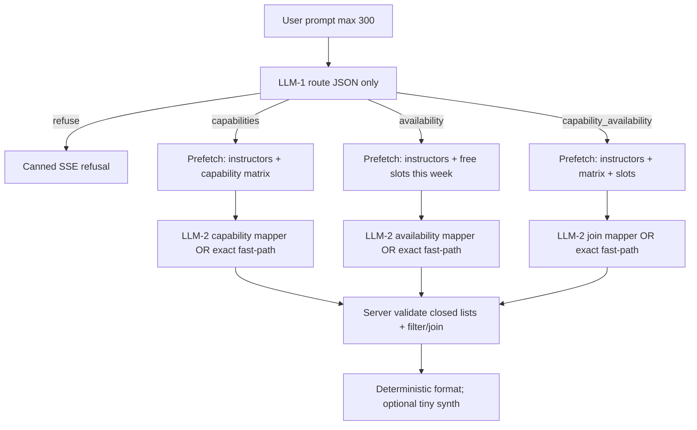

# [9.7] Schedule AI — 3-router implementation plan

**Project:** Etkan MS (`etkan_ms`)  
**Feature:** Manager instructor-schedules assistant  
**Date:** 2026-08-03  
**Status:** Phase 7 mostly done — pipeline QA covered by Vitest (`phase7-qa.test.ts`); UI phase readability still needs a quick manual glance

**Entry UI:** Manager → Instructor schedules → Schedule assistant (prompt ≤ 300 chars)  
**Authz:** `instructor_schedules.view` (unchanged)  
**Model:** Cloudflare Workers AI via existing `runWorkersAiChat` (env model or default)

---

## 1. Goal

Replace the current **tier classifier** (`easy` | `semi` | `complex` | `refuse`) + open L1 tool soup with a **bounded 3-route pipeline**:

| Route | Meaning | Example |
|-------|---------|---------|
| `capabilities` | Who teaches what / what someone teaches | “What can Ali teach?” / “Who teaches Arduino?” |
| `availability` | Who is free when / when someone is free | “When is Ali free?” / “Who is free Friday?” |
| `capability_availability` | Subject ∩ free windows | “Arduino instructors free Friday.” |
| `refuse` | Out of scope | Poems, weather, unrelated chat |

**Efficiency principles**

1. LLM-1 only classifies **route** (+ light hints). Prefetch is **hardcoded from route** in server code.  
2. After prefetch, LLM-2 maps the user message onto **closed catalogs** (no inventing names).  
3. Server validates, filters, and joins. Prefer deterministic answers; optional tiny synth only.  
4. Support **`groups[]`** so one message can hold multiple sub-results.

---

## 2. Locked decisions

| Topic | Decision |
|-------|----------|
| LLM-1 output | `route` + optional `hints` only (not trusted tool lists) |
| Prefetch | Derived in code from `route` (always includes instructor usernames) |
| Capability data | Prefer one **capability matrix** prefetch for capabilities + join routes |
| Fast-path | Skip LLM-2 when exact catalog matches + unambiguous direction |
| Multi-intent | `groups[]` from day one |
| Slots scope | Default current Sunday–Saturday week; compact keys; row caps |
| Workshop slots | Out of scope |
| Writes via AI | Out of scope |
| SSE UI | Keep existing phases; reasoning may show `Routed to …` |
| Refusal | Canned message; no answer LLM |

---

## 3. Target architecture



### 3.1 Route → prefetch map (server)

| Route | Always prefetch |
|-------|-----------------|
| `capabilities` | Instructors (`id` + `username`) + capability matrix (`username` → subject names) and/or subject name list |
| `availability` | Instructors + free slots for current week (compact, capped) |
| `capability_availability` | Instructors + capability matrix + free slots |
| `refuse` | Nothing |

### 3.2 LLM-1 JSON contract

```json
{
  "route": "capabilities" | "availability" | "capability_availability" | "refuse",
  "hints": {
    "weekdays": ["friday"],
    "subject_tokens": ["arduino"],
    "username_tokens": ["ali"]
  }
}
```

- `max_tokens` ≈ 80–100  
- No tools parameter on this call  
- Invalid / truncated JSON → attempt extract/repair; if still unusable and hints/intent clear, optional heuristic route; else `refuse`

### 3.3 Groups contract (LLM-2 + server)

Always an array (length ≥ 1 for in-scope asks):

```json
{
  "groups": [
    {
      "id": "g1",
      "direction": "capability_to_username",
      "usernames": ["ali"],
      "subject_names": ["Arduino Basics"],
      "weekdays": ["friday"],
      "start_time": null,
      "end_time": null
    }
  ]
}
```

| Field | Notes |
|-------|--------|
| `direction` | Route-specific enum (see Phase 3) |
| Empty arrays | Mean “unspecified”; server applies defaults |
| Unknown names | **Scrubbed** against catalogs before filter/join |

### 3.4 Token budget targets

| Path | LLM calls | Target total tokens |
|------|-----------|---------------------|
| refuse | 1 | ~150–250 |
| any route + exact fast-path | 1 | ~200–500 |
| route + LLM-2 | 2 | ~500–1100 |
| + optional synth | +1 | +150–250 |

---

## 4. Edge cases (required handling)

| Case | Handling |
|------|----------|
| Off-topic | LLM-1 `refuse` → canned |
| Typo subject / username | LLM-2 may pick closest **from catalog only**; server drops unknowns |
| Multi-person / multi-subject | Multiple `groups` or multi-valued fields |
| “Arduino Friday” (join, no person) | Join route; filter subjects ∩ Friday slots |
| Availability without weekday | Default this week’s free slots for matched users |
| Empty catalogs | Skip LLM-2; short “nothing configured / no match” |
| Huge slot lists | Week bound + max ~40 rows + `{truncated,total}` |
| LLM-2 invents names | Scrub; if group empty → no-match message |
| Mixed poem + schedule | Route to in-scope; ignore off-topic half |
| Truncated LLM JSON | Repair extract; fallback to hints/fast-path if possible |

---

## 5. Phases and tasks

### Phase 0 — Spec freeze and cleanup inventory

**Outcome:** Old workflow gone; UI + auth stub remain; constants/routes primed for rebuild.

- [x] Confirm locked decisions in §2  
- [x] Wipe old hot path:
  - [x] Deleted `classify` / `orchestrate` / `compact` / `format-answer` / `intent` / `system-prompt` (+ tests)
  - [x] Deleted `services/schedule/schedule-assistant.service.ts` (+ tests)
  - [x] Stripped L1 tool defs from `workers-ai.ts` (kept generic `runWorkersAiChat`)
  - [x] Slimmed validators to prompt-only; constants to UI + routes/caps/weekdays/refusal
  - [x] Stub `assistant/route.ts` (auth + rate limit + rebuild SSE message)
- [x] Keep UI: `schedule-assistant-prompt.tsx` + panel mount + SSE event types  
- [x] Define Zod schemas for: `route`, `hints`, `groups[]`, directions per route  
  - `lib/validators/manager/schedule-assistant.ts` — router + groups + catalogs  
  - `lib/constants/schedule-assistant.ts` — route / direction enums  
- [x] Define compact catalog shapes (`{i,u}`, matrix `{u,sub[]}`, slots `{i,u,d,w,s,e}`)  
  - Zod + `types/schedule-assistant.ts` (`PrefetchCatalogs` bundle)  
- [x] Canned refusal + rebuild message constants

**Exit criteria:** No imports of retired tier/tool modules; UI still loads; stub answers rebuild notice; Phase 0 contracts/schemas in code.

---

### Phase 1 — Prefetch catalogs (server, no LLM)

**Outcome:** Fixed, capped catalog loaders for the three routes.

- [x] `list_instructors` compact: `{ instructors: [{ i, u }], truncated, total }`  
- [x] `list_capability_matrix` (or subjects + pairs): `{ matrix: [{ u, sub: string[] }] }` and/or `{ subjects: string[] }`  
- [x] `list_slots_this_week` compact free slots for current Sun–Sat week  
- [x] Shared caps: max instructors / max slots (constants)  
- [x] `prefetchForRoute(route)` helper returning only what that route needs  
- [x] Unit tests with mocked repositories

**Exit criteria:** Vitest covers empty / truncated / weekday projection for slots.

---

### Phase 2 — LLM-1 router

**Outcome:** Tiny classifier returns only route (+ hints).

- [x] `lib/manager/schedule-assistant/router.ts` — system prompt + parse/repair  
- [x] Prompt includes one example per route + refuse  
- [x] Wire `max_tokens` for classify (~80–100) (`SCHEDULE_ASSISTANT_ROUTER_MAX_TOKENS = 100`)  
- [x] Unit tests: valid JSON, markdown-wrapped, truncated → repair/fallback, refuse  
- [x] Do **not** execute model-suggested tools; prefetch only from `route`

**Exit criteria:** “Arduino instructors free Friday.” parses to `capability_availability` in tests (fixture or heuristic fixture); off-topic → `refuse`.

---

### Phase 3 — LLM-2 mappers + exact fast-path

**Outcome:** Closed-world mapping into `groups[]`, or skip LLM-2 when exact.

#### 3A — Capability mapper

- [x] Directions: `username_to_capability` | `capability_to_username`  
- [x] Prompt: user message + compact instructors + subject/matrix lists  
- [x] Parse → scrub usernames/subjects against catalogs  
- [x] Server resolve: filter matrix by direction (no inventing pairs)

#### 3B — Availability mapper

- [x] Directions: `username_to_slots` | `slots_to_username`  
- [x] Prompt: message + usernames + compact slots (or slot summary)  
- [x] Parse weekdays / optional HH:mm window  
- [x] Server filter slots by usernames ∩ weekdays ∩ time window

#### 3C — Join mapper

- [x] Direction: e.g. `subject_and_availability` (optional usernames)  
- [x] Prompt: message + matrix + slots  
- [x] Server: subject → instructor ids ∩ free slots (day/window)

#### 3D — Exact fast-path

- [x] If tokens exactly match catalog username(s) / subject(s) / weekday(s) and direction is unambiguous → build `groups` in TypeScript, set `skipped_llm2: true`  
- [x] Unit tests for fast-path and scrub-unknowns

**Exit criteria:** Each mapper has parse tests; join intersect test; fast-path skips LLM-2 in unit tests (mocked).

---

### Phase 4 — Resolve groups + answer formatting

**Outcome:** Server turns validated groups into facts and user-facing text.

- [x] `resolve-groups.ts` — validate enums, scrub, apply filters/joins per group (shipped Phase 3; wired via `answer.ts`)  
- [x] Deterministic formatter: bullets grouped by `groups[].id` / direction  
- [x] Empty results → clear “no match” copy (no hallucination)  
- [x] Optional tiny synth: system ~4 lines + `Q:` + `DATA:`; **no tools**; small `max_tokens` (helpers only; default path uses formatter)  
- [x] Prefer formatter; synth only when narrative needed

**Exit criteria:** Snapshot/unit tests for capability list, free windows, join empty/non-empty.

---

### Phase 5 — API route rewrite + SSE + logging

**Outcome:** Production hot path uses 3-router pipeline only.

- [x] Rewrite `app/api/manager/instructor-schedules/assistant/route.ts`:
  1. Validate prompt  
  2. LLM-1 → route  
  3. refuse → canned SSE  
  4. prefetch  
  5. fast-path or LLM-2  
  6. resolve groups  
  7. format / optional synth  
  8. stream tokens + `done`
- [x] Emit reasoning like `Routed to capability_availability…` / `Prefetching catalogs…` / `Mapping…`  
- [x] Keep tool SSE events if prefetch is surfaced as tool_start/tool_result (optional but nice for UI)  
- [x] `recordCloudflareAiUsage` metadata: `route`, `groups`, `llm_calls`, `prefetch`, `skipped_llm2`, `tools_used`  
- [x] Rate limit unchanged  
- [x] Remove closing full-history + tools call (must stay gone)

**Exit criteria:** Manual smoke with Cloudflare env: three happy paths + refuse; usage row shows `route`.

---

### Phase 6 — Dead code removal and docs sync

**Outcome:** Hot path has one architecture; docs match reality.

- [x] Remove or quarantine unused tier classify / old tool-loop helpers from hot path  
- [x] Keep compact helpers if still used  
- [x] Update any assistant-related notes under `[9.6] Workshop schedule` that contradict this plan (cross-link to `[9.7]`)  
- [x] Mark phases complete in this file as they ship

**Exit criteria:** No imports of retired tier orchestrator from the API route; `tsc` + targeted Vitest green.

---

### Phase 7 — QA checklist

Automated coverage: `lib/manager/schedule-assistant/phase7-qa.test.ts` (router → map → answer; Zod 300/301). Live Cloudflare smoke remains optional.

- [x] “Who teaches Arduino?” → capabilities → names  
- [x] “What can &lt;username&gt; teach?” → capabilities → subjects  
- [x] “Who is free Friday?” → availability  
- [x] “When is &lt;username&gt; free?” → availability  
- [x] “Arduino instructors free Friday.” → join → intersected free slots  
- [x] Off-topic → canned refuse  
- [x] Typo subject with close catalog match → still useful or empty (no invented subject)  
- [x] Prompt at 300 chars still works; 301 rejected by Zod  
- [ ] UI phases still readable (manual: open assistant, confirm reasoning / tools / answer phases)

---

## 6. Suggested file map

| Area | Path (suggested) |
|------|------------------|
| LLM-1 router | `lib/manager/schedule-assistant/router.ts` |
| Prefetch | `lib/manager/schedule-assistant/prefetch.ts` |
| Mappers | `lib/manager/schedule-assistant/mappers/capabilities.ts`, `availability.ts`, `join.ts` |
| Fast-path | `lib/manager/schedule-assistant/fast-path.ts` |
| Resolve | `lib/manager/schedule-assistant/resolve-groups.ts` |
| Format | `lib/manager/schedule-assistant/format-answer.ts` (adapt) |
| Prompts | `lib/manager/schedule-assistant/system-prompt.ts` (split ROUTER / MAP_* / SYNTH) |
| Constants | `lib/constants/schedule-assistant.ts` (routes, caps, max_tokens) |
| Validators | `lib/validators/manager/schedule-assistant.ts` |
| Service | `services/schedule/schedule-assistant.service.ts` (catalog fetchers) |
| API | `app/api/manager/instructor-schedules/assistant/route.ts` |
| Tests | colocated `*.test.ts` for router, prefetch, mappers, resolve, fast-path |

---

## 7. Out of scope

- Workshop entity schedule slots in this assistant  
- Create / update / delete via AI  
- Changing Cloudflare model unless already set via env  
- Cross-request catalog caching (optional later)  
- New permissions or routes  

---

## 8. Implementation order (summary)

1. **Phase 0** — contracts + inventory  
2. **Phase 1** — prefetch catalogs  
3. **Phase 2** — LLM-1 router  
4. **Phase 3** — mappers + fast-path  
5. **Phase 4** — resolve + format  
6. **Phase 5** — API/SSE/logging  
7. **Phase 6** — cleanup  
8. **Phase 7** — QA  

Do not start Phase 5 until Phases 1–4 have unit tests for the happy paths above.
