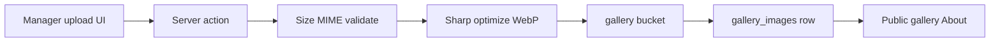

# Gallery Feature — Supabase Storage Plan

Phased plan for moving manager gallery from Google Drive URL paste to Supabase Storage uploads, with validation, server image optimization, CRUD, and grid/table manager views.

## Decisions (locked)

- One fixed public bucket `gallery` via migration — **no runtime bucket creation**
- **Do not change `gallery_images` columns** — keep `name` + `direct_url` as today; `direct_url` stays the single source of truth for display
- After upload, store the Supabase public object URL in `direct_url` (same role as today’s Drive URL)
- New uploads go to Storage; existing Drive `direct_url` rows keep working via current URL helper until replaced
- On delete/replace: if `direct_url` is a `gallery` bucket public URL, derive object path from it and remove the file; skip storage delete for legacy Drive URLs
- Validate client + server: ≤15MB; `image/jpeg|png|webp|gif`
- Optimize on server with Sharp (resize + WebP) before upload
- Manager UI: table view (current) + grid view (thumbnails)
- Drop URL-based bulk JSON import; replace with multi-file upload
- Mirror existing patterns: `projects` / `blogs` storage repos + RLS

## Current baseline

- Manager: `/manager/gallery` — name + pasted URL only (`components/manager/gallery/manage-gallery-panel.tsx`)
- DB: `gallery_images` (`name`, `direct_url` unique) — **schema stays unchanged** (`docs/[05] Database/etkan-ms-schema-latest-dbdiagram.dbml`)
- Public: Drive thumbnail rewrite (`lib/utils/gallery-image-url.ts`)
- Storage precedents: `repositories/blog-storage.repository.ts`, blogs migration bucket insert

---

## Phase 1 — Bucket only (no table alter) ✅

- Migration: create public `gallery` bucket (`file_size_limit` 15MB, mime allowlist), storage RLS (public read, authenticated write/update/delete) like blogs — `supabase/migrations/20261011120000_gallery_storage_bucket.sql`
- **No** `gallery_images` column changes; no `storage_path`; DBML note updated (files in Storage, URL still in `direct_url`)
- Add `gallery` to `lib/constants/backup-storage.ts` + `docs/[03] Config/local-supabase.md` storage cp list
- Constant: `lib/manager/gallery/storage-path.ts` → `GALLERY_STORAGE_BUCKET`

---

## Phase 2 — Storage + image pipeline ✅

- `repositories/gallery-storage.repository.ts` — upload / getPublicUrl / remove (clone blog/projects pattern)
- Helpers in `lib/manager/gallery/storage-path.ts` — parse object path from a `gallery` public `direct_url` (null for Drive/external)
- `lib/manager/gallery/optimize-image.ts` — Sharp: max edge 2048, WebP q82, strip metadata; reject oversize/invalid mime
- Constants: `lib/constants/manager-gallery.ts` (15MB, mime allowlist)
- Service: `createGalleryImageFromUploadForManager` / `updateGalleryImageFromUploadForManager`; delete + URL change remove Storage object when URL maps to bucket
- Permissions stay `gallery.create|update|delete|view` — assert in service
- `sharp` added as a direct dependency

---

## Phase 3 — Actions + validators ✅

- File Zod validators: `create-gallery-image.ts` / `update-gallery-image.ts` (≤15MB, mime allowlist; file optional on update)
- Actions call `createGalleryImageFromUploadForManager` / `updateGalleryImageFromUploadForManager` / delete (row + object)
- Removed bulk JSON path (validator, action, `bulk-gallery-json-form`, panel tab)
- `revalidatePublicGallery()` kept on success
- Add/edit dialogs: file input + `useFormActionState` + pending-aware open change

---

## Phase 4 — Manager UI ✅

- Upload UI in add/edit dialogs with drag-and-drop (`GalleryImageDropzone`), client pre-check (`validateGalleryImageClientFile`: ≤15MB + mime/extension) + InlineSpinner on submit
- View toggle on manage panel: **Table** (preview + CRUD) and **Grid** (thumbnail + name + actions)
- Copy-URL / edit / delete work for Storage and legacy Drive rows (`toEmbeddableGalleryImageUrl` for thumbs)
- No top-loader for upload submits

---

## Phase 5 — Public display cleanup ✅

- `toEmbeddableGalleryImageUrl` + `isSupabasePublicStorageUrl`: Drive rewrite for legacy; Storage public URLs pass through
- `GalleryPublicImage`: `next/image` for Storage URLs; native `` for Drive thumbnails
- Wired on public gallery marquee + about foundations (same gallery URL list)

---

## Phase 6 — Ops + verify ✅

- Local migration `20261011120000` applied; `gallery` bucket present (15MB) — skipped full `db reset` (destructive; not required)
- Smoke: `npm run smoke:gallery` → [`scripts/smoke-gallery-storage.ts`](../../scripts/smoke-gallery-storage.ts) — upload → replace (old object removed) → delete (no orphan)
- Unit tests: `lib/manager/gallery/*` + `gallery-image-url` (22 passed)
- Optional later (out of scope): one-off script to pull Drive files into Storage

## Out of scope

- Runtime/dynamic buckets
- Full automated Drive → Storage migration (optional follow-up)
- Changing public marquee layout design
